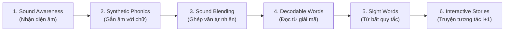
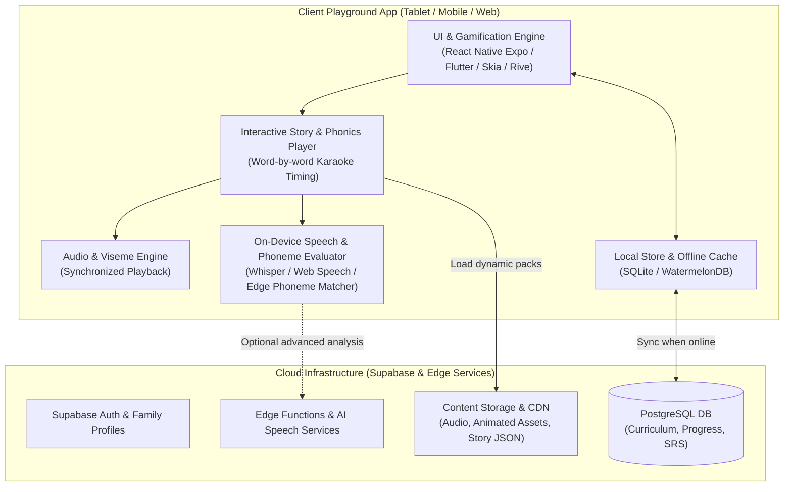
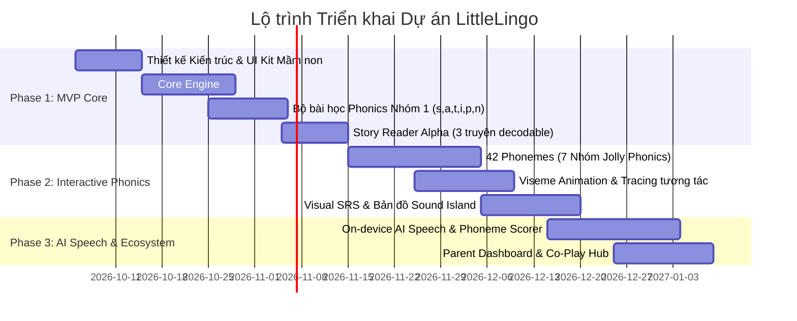

# ĐỀ XUẤT THIẾT KẾ & XÂY DỰNG ỨNG DỤNG HỌC TIẾNG ANH TƯƠNG TÁC CHO TRẺ (3–5 TUỔI)
**Hội đồng Dự án:** Minh Chủ Thoan (Chủ trì quyết định) • PE Architect (Perplexity Pro — Claude Sonnet Thinking) • AN Engineer (Antigravity)  
**Thời gian lập:** 2026-10-03 23:20:25 +09:00

---

## 1. TỔNG QUAN & ĐỊNH VỊ DỰ ÁN

- **Tên định hướng:** *LittleLingo / WonderPhonics Playground*
- **Đối tượng trọng tâm:** Trẻ mầm non và tiền tiểu học (3 – 5 tuổi).
- **Mục tiêu cốt lõi:**
  1. **Không áp lực - Học qua chơi (Edutainment):** Tận dụng "thời kỳ vàng" tiếp thu ngôn ngữ (Critical Period Hypothesis) mà không gây sợ hãi hay chán nản.
  2. **Tránh mất gốc & chuẩn hóa phát âm ngay từ đầu:** Xây dựng nhận thức âm vị (Phonemic Awareness) vững chắc trước khi đọc chữ; ngăn ngừa hiện tượng "Việt hóa" âm tiếng Anh (nuốt âm cuối, thiếu trọng âm, phát âm sai phụ âm vô thanh/hữu thanh).
  3. **Phiên học siêu ngắn (Micro-sessions):** Thiết kế cho chu kỳ chú ý 5–8 phút của trẻ mầm non.

---

## 2. KHUNG PHƯƠNG PHÁP LUẬN SƯ PHẠM QUỐC TẾ



### 2.1. Bốn trụ cột phương pháp luận
1. **Synthetic Phonics (Tiêu chuẩn Jolly Phonics & Oxford Phonics World):**
   - Không dạy theo bảng chữ cái A-B-C thông thường (gây rối loạn âm thanh khi ghép vần).
   - Dạy theo 7 nhóm âm Jolly Phonics: Nhóm 1 bắt đầu bằng `/s/, /a/, /t/, /i/, /p/, /n/`. Chỉ cần học xong nhóm 1, trẻ đã có thể tự giải mã (blend) hàng chục từ có nghĩa: *sat, tap, pin, pat, tin, sit, nip*.
2. **TPR (Total Physical Response - GS. James Asher):**
   - Kết hợp ngôn ngữ với vận động cơ thể (vận động thô & vận động tinh). Mỗi âm vị đi kèm một động tác hình tượng (ví dụ: âm `/s/` uốn lượn tay như chú rắn, âm `/p/` thổi nhẹ như ngọn nến).
3. **Comprehensible Input & Natural Approach (GS. Stephen Krashen):**
   - Tôn trọng giai đoạn **"Silent Period" (Thời kỳ im lặng)**: Cho phép trẻ nghe hiểu và phản hồi qua chạm/hành động trước khi bị ép phải mở miệng nói.
   - Nguyên lý $$i+1$$: Nội dung mới luôn được neo vào ngữ cảnh quen thuộc (hình ảnh, hành động, biểu cảm) để trẻ tự suy luận nghĩa mà không cần dịch ngữ.
4. **Visual Spaced Repetition (SRS thích ứng cho trẻ em):**
   - Ôn tập ngầm định kỳ (1 ngày, 3 ngày, 7 ngày, 14 ngày) được ẩn dưới dạng mini-game hoặc vòng quay may mắn, tuyệt đối không tạo cảm giác "bài kiểm tra".

### 2.2. Cơ chế phòng ngừa triệt để lỗi phát âm
- **Phân biệt cặp âm tối thiểu (Minimal Pairs):** Thiết kế mini-game phân biệt `/p/ - /b/`, `/s/ - /ʃ/ (sh)`, `/t/ - /d/`, `/ɪ/ - /iː/` bằng trực quan âm thanh và chọn hình ảnh.
- **Khẩu hình chuyển động (Mouth-Shape Viseme Animation & Front Mirror Mode):**
  - Video hoạt hình 2D/3D phóng to khẩu hình miệng, vị trí răng, lưỡi và luồng hơi.
  - Chế độ "Gương thần" (Front Camera Mirror) chạy on-device giúp trẻ tự soi khẩu hình của mình khi phát âm.
- **AI Phoneme Alignment & Gentle Feedback:**
  - Chấm điểm và phân tích ở cấp độ từng âm vị (Phoneme level), ví dụ trẻ đọc "cat" thành "tat" -> Hệ thống chỉ ra âm `/k/` cần hỗ trợ, kích hoạt mini-drill luyện âm `/k/`.
  - Triết lý "No-fail psychology": Không báo "Sai", tối đa 2 lần nhắc mẫu nhẹ nhàng: *"Great try! Let's listen again: sss-un!"*.

---

## 3. ĐỐI CHUẨN THỊ TRƯỜNG & ĐIỂM ĐỘT PHÁ

| Nền tảng | Điểm mạnh kế thừa | Hạn chế cần khắc phục | Ứng dụng của chúng ta |
| :--- | :--- | :--- | :--- |
| **Raz-Kids (Learning A-Z)** | Hệ thống Leveled Readers chuẩn hóa (AA → Z); cơ chế Karaoke highlight từng từ; vòng lặp Listen → Read → Record. | Hướng đến học sinh K–5, bài kiểm tra (quiz) bằng chữ viết nặng tính trường lớp; không phù hợp trẻ 3 tuổi chưa biết đọc. | Kế thừa karaoke highlight và leveled decodable reader; thay quiz chữ bằng **Touch-to-Answer** và tương tác động. |
| **PalFish** | Thư viện tranh truyện đồ sộ; chạm để phát âm; AI chấm phát âm; nhân vật sinh động. | Quá phụ thuộc vào mô hình gia sư live/bán khóa học; AI phản hồi cứng nhắc với trẻ nhỏ; nhiều tính năng phân tâm. | Kế thừa **Touch-to-Speak** & **Interactive Hotspots**; tinh chỉnh AI phản hồi khích lệ không áp lực; tối ưu trải nghiệm tập trung. |
| **Khan Academy Kids** | Trải nghiệm hoàn toàn miễn phí, nhân vật dẫn truyện ấm áp, đồ họa xuất sắc, bài học đa giác quan. | Phạm vi dàn trải (Toán, Logic, Kỹ năng cảm xúc); chưa chuyên biệt sâu cho việc chuẩn hóa phát âm và phonics tiếng Anh cho người học ESL/EFL. | Kế thừa nhân vật đồng hành và lộ trình cá nhân hóa; **tập trung chuyên sâu 100% vào Phonics, Speaking & Early Reading**. |

### Các điểm đột phá (Key Innovations):
1. **Interactive Story Reactor (Tranh truyện tương tác đa tầng):** Không chỉ lật trang tĩnh, trẻ chạm vào các điểm nóng (hotspots) để kích hoạt chuyển động, nghe hiệu ứng âm thanh và khám phá ngữ cảnh.
2. **TPR Motion Mode:** Sử dụng nhận diện cử chỉ nhẹ hoặc chuyển động chạm để kích thích vận động kết hợp phát âm.
3. **Phonics Sound Island (Bản đồ thám hiểm âm thanh):** Mỗi cụm âm là một hòn đảo kỳ thú, trẻ mở khóa từ vựng và câu chuyện mới theo tiến độ tự nhiên.
4. **Parent Co-Play Card:** Mỗi bài học cung cấp một thẻ gợi ý hành động 1 phút để phụ huynh tương tác cùng con ngoài đời thực (không tốn thời gian, không đòi hỏi phụ huynh phải giỏi tiếng Anh).

---

## 4. THIẾT KẾ KIẾN TRÚC KỸ THUẬT & CÔNG NGHỆ



### 4.1. Tech Stack Khuyến nghị
- **Frontend / Client App:** **React Native (với Expo Router)** hoặc **Flutter**.
  - Lý do: Đa nền tảng (ưu tiên iPad/Tablet - kích thước màn hình vàng cho trẻ 3-5 tuổi), hỗ trợ đồ họa 2D phong phú (`@shopify/react-native-skia`, `rive-react-native`).
- **Interactive Story & Karaoke Player:**
  - Đồng bộ âm thanh chính xác theo microsecond (JSON word timestamps).
  - Tương tác Hotspot vector dạng hộp to bản (touch target tối thiểu 48x48dp cho ngón tay trẻ).
- **Audio & Speech Engine:**
  - Phát âm thanh chất lượng cao chuẩn người bản xứ (US/UK accent).
  - Nhận diện giọng nói trẻ em (Child Speech Recognition) là bài toán đặc thù: Dùng On-device Whisper Tiny / Web Speech API kết hợp Heuristic Phoneme Matching để có kết quả phản hồi tức thì (<200ms) không phụ thuộc mạng.
- **Backend & Database:** **Supabase (PostgreSQL + Auth + Storage + RLS + Edge Functions)**.
  - Phù hợp tuyệt đối với hạ tầng sẵn có và quy định bảo mật riêng tư trẻ em (COPPA / GDPR-K).

---

## 5. ĐẶC TẢ DỮ LIỆU BÀI HỌC (DATA SCHEMAS)

### 5.1. Schema Bài Học Phonics Tương Tác
```json
{
  "$schema": "https://json-schema.org/draft/2020-12/schema",
  "lesson_id": "phonics_g1_s",
  "title": "The Snake Sound /s/",
  "phonics_group": 1,
  "target_phoneme": "/s/",
  "grapheme": "s",
  "age_band": [3, 5],
  "tpr_action": {
    "title": "Weave like a snake",
    "description": "Move hand in an S-shape saying sssss",
    "icon": "assets/tpr/snake_wave.png"
  },
  "mouth_guide": {
    "animation": "assets/visemes/mouth_s.riv",
    "tips_vi": "Khép nhẹ hai hàm răng, đầu lưỡi đặt sau răng cửa dưới và thổi hơi nhẹ ra ngoài: sss"
  },
  "activities": [
    {
      "step": 1,
      "type": "sound_intro",
      "audio_prompt": "assets/audio/prompts/listen_s.mp3",
      "interactive_object": "snake",
      "on_tap_audio": "assets/audio/phonemes/s.mp3"
    },
    {
      "step": 2,
      "type": "sound_discrimination",
      "instruction_audio": "assets/audio/prompts/find_the_sound.mp3",
      "target_sound": "/s/",
      "cards": [
        { "id": "c1", "word": "sun", "image": "assets/img/sun.png", "audio": "assets/audio/words/sun.mp3", "is_correct": true },
        { "id": "c2", "word": "sock", "image": "assets/img/sock.png", "audio": "assets/audio/words/sock.mp3", "is_correct": true },
        { "id": "c3", "word": "ball", "image": "assets/img/ball.png", "audio": "assets/audio/words/ball.mp3", "is_correct": false }
      ]
    },
    {
      "step": 3,
      "type": "bubble_blending",
      "blended_word": "sat",
      "bubbles": [
        { "phoneme": "/s/", "audio": "assets/audio/phonemes/s.mp3" },
        { "phoneme": "/æ/", "audio": "assets/audio/phonemes/a.mp3" },
        { "phoneme": "/t/", "audio": "assets/audio/phonemes/t.mp3" }
      ],
      "result_reward": "assets/anims/sat_cat.riv"
    }
  ]
}
```

### 5.2. Schema Tranh Truyện Đọc Giải Mã (Decodable Story Reader)
```json
{
  "story_id": "decodable_01_cat_sat",
  "title": "The Cat Sat",
  "level": "Decodable-Level-1",
  "decodable_words": ["cat", "sat", "mat"],
  "sight_words": ["the", "on"],
  "pages": [
    {
      "page_index": 1,
      "background_image": "assets/stories/cat_sat/bg_p1.png",
      "narration_audio": "assets/stories/cat_sat/narration_p1.mp3",
      "full_text": "The cat sat on the mat.",
      "words_timing": [
        { "word": "The", "start_ms": 0, "end_ms": 320 },
        { "word": "cat", "start_ms": 350, "end_ms": 780 },
        { "word": "sat", "start_ms": 820, "end_ms": 1200 },
        { "word": "on", "start_ms": 1250, "end_ms": 1450 },
        { "word": "the", "start_ms": 1480, "end_ms": 1680 },
        { "word": "mat.", "start_ms": 1720, "end_ms": 2200 }
      ],
      "hotspots": [
        {
          "id": "cat_character",
          "rect": [150, 240, 200, 180],
          "tap_action": "play_animation_and_sound",
          "sound": "assets/audio/sfx/meow.mp3",
          "animation": "cat_purr"
        }
      ],
      "speaking_challenge": {
        "is_optional": true,
        "target_word": "cat",
        "expected_phonemes": ["/k/", "/æ/", "/t/"],
        "praise_audio": "assets/audio/prompts/great_job.mp3"
      }
    }
  ]
}
```

---

## 6. LỘ TRÌNH TRIỂN KHAI (ROADMAP)



### Chi tiết các giai đoạn:
1. **Phase 1 — MVP "Play & Listen" (4–6 tuần):**
   - Hoàn thiện UI/UX chuẩn cho trẻ 3–5 tuổi (màu sắc ấm, nút bấm lớn, không văn bản cản trở).
   - Core Engine chạy bài học Phonics: Sound Awareness, Tap-to-sound, Bubble Drag-to-blend.
   - Core Reader chạy 3 truyện Decodable ngắn có karaoke highlight từng từ và hotspot chạm.
   - Hoạt động 100% Offline (Local first).
2. **Phase 2 — Interactive Phonics & Gamification (6–8 tuần):**
   - Đầy đủ 42 âm vị theo 7 nhóm Jolly Phonics.
   - Mouth-shape guide trực quan và mini-game phân biệt cặp âm tối thiểu (Minimal Pairs).
   - Hệ thống đảo âm thanh (Sound Island) và vòng lặp ôn tập thích ứng (Adaptive SRS).
3. **Phase 3 — AI Speech & Smart Ecosystem (8–12 tuần):**
   - Tích hợp Speech Evaluation thân thiện cho trẻ, chỉ ra âm vị cần hoàn thiện.
   - Thư viện 50+ truyện Decodable Readers theo từng cấp độ tiến triển.
   - Dashboard cho phụ huynh theo dõi mà không làm gián đoạn trải nghiệm của trẻ.

---

## 7. QUY CHẾ PHÂN QUYỀN (GOVERNANCE MATRIX)

Tuân thủ nghiêm ngặt **Quy trình Phối hợp Tự trị (PE - THOAN - AN)**:

- 🏛️ **MAJOR_CHANGE (Bắt buộc Minh Chủ Thoan phê duyệt trước khi thi công):**
  1. Lựa chọn Framework công nghệ chính (React Native Expo vs Flutter vs Web Canvas).
  2. Quyết định mở rộng/thay đổi triết lý sư phạm (ví dụ: bổ sung thêm phương pháp khác ngoài Phonics).
  3. Lựa chọn bên thứ ba cung cấp AI Speech Engine (nếu dùng dịch vụ Cloud có phí).
  4. Thay đổi schema cơ sở dữ liệu production trên Supabase.
  5. Phát hành phiên bản App Store / Google Play hoặc phân phối diện rộng.

- ⚙️ **MINOR_CHANGE (AN tự động thi công, kiểm thử và chuyển PE thẩm định):**
  1. Khởi tạo cấu trúc source code, setup scripts, cấu hình linter, test runner.
  2. Viết các mẫu dữ liệu JSON bài học (Lesson schemas) và truyện mẫu (Sample decodable stories).
  3. Xây dựng components giao diện: Audio player, Karaoke text highlighter, Bubble blender, Hotspot canvas.
  4. Tối ưu thuật toán khớp âm thanh và hiệu năng tương tác kéo thả.
  5. Sửa lỗi logic, sửa bug hiển thị, cập nhật asset hình ảnh/âm thanh hợp lệ.

---
*Báo cáo được lập bởi Kỹ sư AN và Thẩm định bởi Kiến trúc sư trưởng PE.*
